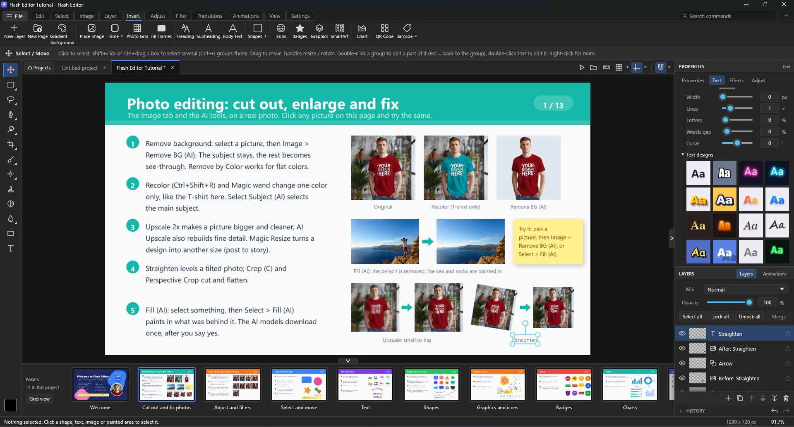
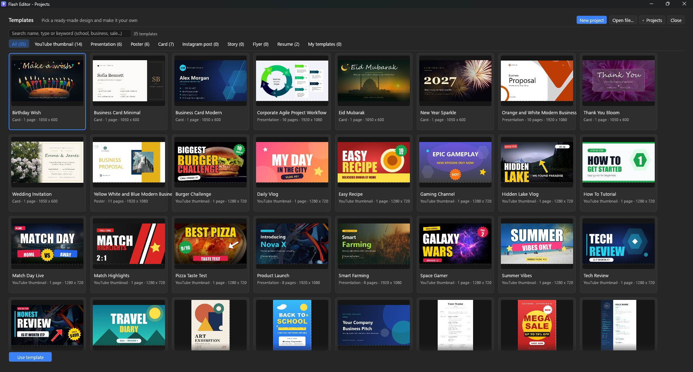
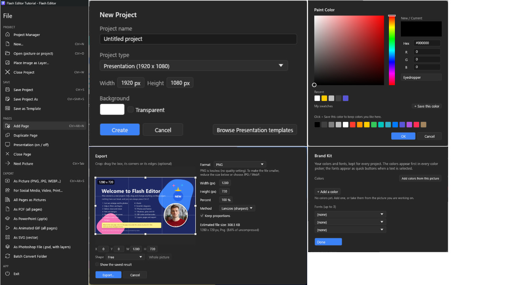
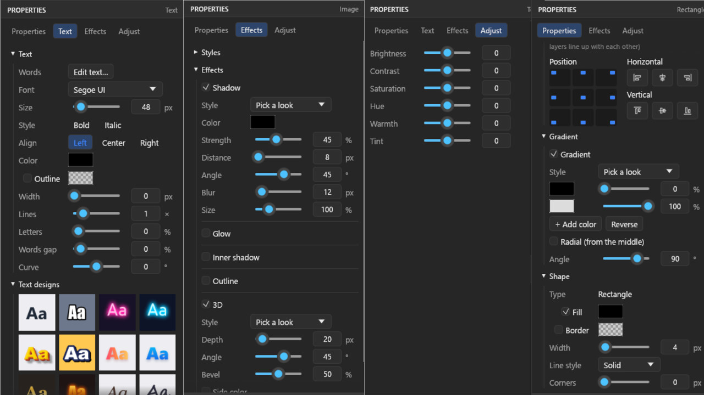
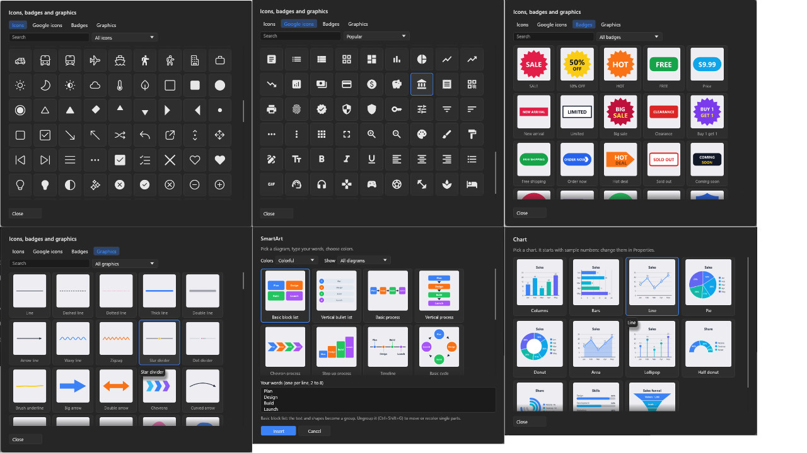
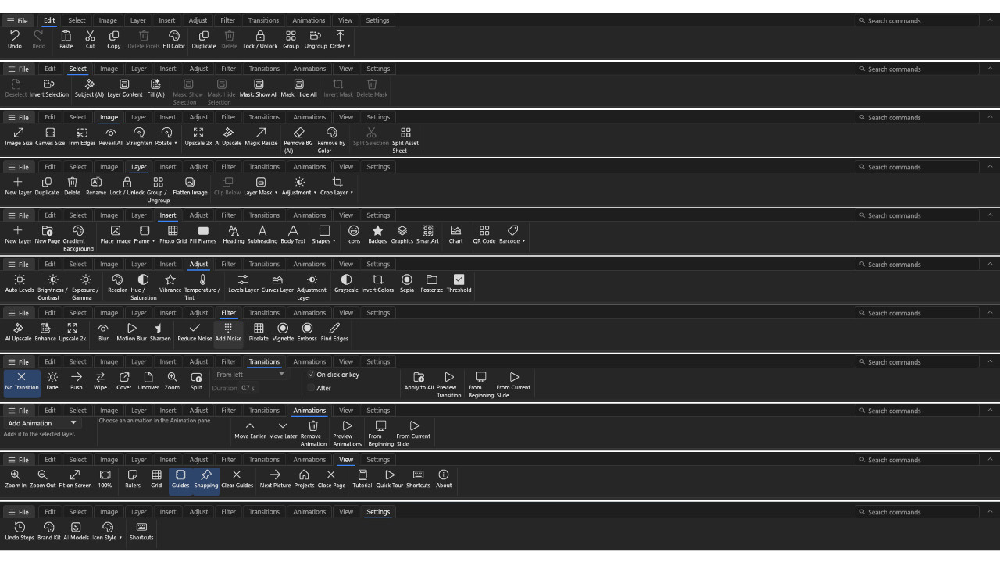

<p align="center"></p>

<h1 align="center">Flash Editor</h1>

<p align="center">
  A fast picture editor, design tool and presentation maker for Windows.<br>
  Photoshop and Canva in one small program, with offline AI tools.
</p>

<p align="center">
  <a href="https://github.com/RahatAlamgir/Flash-Editor-Rust/releases/latest">
    
  </a>
</p>

<p align="center">
  
  
  
</p>

<p align="center">
  
</p>

## ✨ Why Flash Editor

- ⚡ **Small and quick.** The program is about 20 MB (the installer 21 MB), opens fast and uses little memory.
- ✏️ **Everything editable.** Text, shapes, charts, QR codes and pictures stay objects you can change at any time.
- 🤖 **Offline AI.** Remove a background, remove an object, upscale a photo: on your own computer, nothing is uploaded.
- 🎞️ **Pictures and presentations in one place.** Design a page, or make a slideshow with transitions and animations.

## 🖼️ Screenshots

<table>
  <tr>
    <td width="50%" align="center" valign="top">
      <br>
      <sub>Start from a ready-made template, or a blank page.</sub>
    </td>
    <td width="50%" align="center" valign="top">
      <br>
      <sub>File menu, new project, colours, export with crop, Brand Kit.</sub>
    </td>
  </tr>
  <tr>
    <td width="50%" align="center" valign="top">
      <br>
      <sub>Properties: text, effects (shadow, glow, 3D), adjustments, gradients.</sub>
    </td>
    <td width="50%" align="center" valign="top">
      <br>
      <sub>Icons, badges, graphics, SmartArt and charts to insert.</sub>
    </td>
  </tr>
</table>

<p align="center">
  <br>
  <sub>Every tool is one click away in the ribbon, or in the command search.</sub>
</p>

## 📥 Download and install

1. Open the **[latest release](https://github.com/RahatAlamgir/Flash-Editor-Rust/releases/latest)** and download
   `FlashEditor-Setup-1.0.0.exe`.
2. Run it and follow the steps. The installer can also download the AI models (about 470 MB, optional).
3. Windows may say "Windows protected your PC", because the installer is not code-signed yet. Click **More info**, then
   **Run anyway**.

Needs Windows 10 or 11 (64-bit). Uninstalling removes everything the installer put on your computer.

## 🧰 What you can do

### 🎨 Design
- Layers with masks, clipping, groups and adjustment layers; several pages per project; undo with a history list.
- Text in any installed font, curved text and ready text designs. Shapes, gradients, shadow, glow, outline and 3D effects.
- Charts (11 kinds), QR codes, barcodes, SmartArt, photo grids and picture frames.
- About 400 Windows icons, 2,200 Google Material icons, 52 badges and 148 graphics to insert.
- Smart guides, snapping, rulers, grid, and distances shown when you hold **Alt**.
- A Brand Kit and saved styles; online templates from the Project Manager.

### 📷 Edit photos
- Brushes, eraser, Clone Stamp, Healing, Patch, Dodge and Burn, Blur and Sharpen, Liquify.
- Every selection tool, Select Subject, Remove by Color.
- Levels, Curves, 10+ adjustments and filters with a live preview, crop and perspective crop, Magic Resize.

### 🤖 AI, offline
- Remove Background (the cut-out stays editable), Fill (AI), Remove Brush, Click Select and AI Upscale.
- Runs on the graphics card (DirectML) or the processor. Models load only when used and are released after 5 idle minutes.

### 📽️ Presentations
- Slide transitions and object animations, a slideshow on **F5**, export to PowerPoint.
- **Opens PowerPoint (.pptx) files:** each slide becomes a page with editable text, shapes and pictures.

### 📁 Files
- Open and export PNG, JPEG, WebP, GIF (animated), PDF, SVG, PSD and PowerPoint. Also opens HEIC, AVIF and RAW.
- Export with a crop box, size and quality, and see the real file size before saving. Batch Convert and Export All Pages.
- Projects are saved as `.fe`, a small file with lossless pictures. Autosave and crash recovery.

Press **F1** for the keyboard shortcuts, or open **Quick Tour** from the app to be guided.

## 🚀 Performance

- Program: about 20 MB. Installer: about 21 MB.
- Memory with nothing open: about 80 MB.
- Idle CPU: about 0 %. AI models are loaded only when used and freed after 5 idle minutes.

## 🤖 AI models

The models are not in the program. Each one is downloaded once, after asking (in the installer, or the first time you use the
tool), checked with SHA-256 and saved in the `models` folder next to the program. After that everything works offline.
**Settings > AI Models** lists them and can download or delete each one.

| Model | Used for | Download | License |
|---|---|---|---|
| IS-Net general use (rembg project) | Remove Background, Select Subject | 170 MB | Apache 2.0 |
| LaMa big-lama (ONNX by Carve) | Remove / Fill (AI) | 198 MB | Apache 2.0 |
| Real-ESRGAN x4plus (ONNX, Qualcomm AI Hub) | AI Upscale / Clean Up | 62 MB | BSD-3 |
| MobileSAM (Acly/MobileSAM) | Click Select (AI) | 44 MB | MIT / Apache 2.0 |

## ⌨️ Keyboard shortcuts (most used)

Press **F1** in the app for the full list; every shortcut can be changed.

| Keys | Action |
|---|---|
| V / M / L / P / W | Select & move / rectangle-ellipse select / lasso / pen / quick select-magic wand |
| B / E / R / G / I | Brush / eraser / refine / bucket / eyedropper |
| T / C / H / Z | Text / crop / hand / zoom |
| Ctrl+Z, Ctrl+Y | Undo, redo |
| Ctrl+C, Ctrl+X, Ctrl+V | Copy, cut, paste |
| Ctrl+G, Ctrl+Shift+G | Group, ungroup |
| Ctrl+D, Ctrl+L | Duplicate, lock / unlock |
| Ctrl+S / Ctrl+Shift+S | Save project (.fe) / save project as |
| Ctrl+Alt+S | Export as a picture |
| Ctrl+Alt+N | Add a page |
| F5 | Slideshow |
| Space + drag, mouse wheel | Pan, zoom |

## 📝 Notes and limits

- Export merges all visible layers into one picture. To keep your layers, save as a project (`.fe`) with Ctrl+S.
- JPG has no transparency: transparent areas are filled with the background color.
- AI background removal keeps the main subject; fix mistakes with the Refine brush (R).
- Opening a PowerPoint file brings in text, shapes, lines, pictures and tables. Charts, SmartArt and videos are skipped.
- Tested with hand-built Photoshop files only, not with Photoshop itself.

## 🗂️ Project structure

```
Flash Editor Rust/
├── Cargo.toml              Workspace: shared dependency versions, build profiles (fat LTO, stripped)
├── rustfmt.toml            Code formatting rules
├── assets/icons/app/       App icon (.ico for the exe and installer, .png for the window)
├── crates/
│   ├── fe-core/            Image engine, no UI: imaging (tiles), document (pages, layers, animations, transitions), objects,
│   │                       render (tiny-skia), text (fontdb + rustybuzz), selection, history, paint, retouch, transform,
│   │                       effects, layout (snapping), codes (QR, barcodes), io (.fe, PNG, PSD, PDF, PPTX, SVG...), library
│   ├── fe-ai/              AI models: download and checks, ONNX runtime, segmentation, inpainting, upscaling
│   ├── fe-gpu/             Canvas renderer: combined tiles as textures, zoom levels, background jobs
│   ├── fe-ui-kit/          Look and feel: theme (colors, sizes, fonts), icons, widgets (ribbon button, sliders...)
│   └── fe-app/             The program
│       ├── build.rs        Puts the icon into the exe
│       ├── examples/       build_templates: makes the template projects
│       └── src/
│           ├── main.rs     Starts logging and the window
│           ├── app/        Start-up, app state, layout (collapsible panels), keyboard, clipboard, paths, settings
│           ├── commands/   What buttons and shortcuts do (edit, file, layers, pages, objects, presentation...)
│           ├── tools/      Tool catalog, options bar, selecting/, moving/, painting/, retouching, snapping
│           ├── canvas/     Canvas view: zoom / pan, input, rulers, grid, guides, selection overlay, distance guides
│           ├── panels/     ribbon/, toolbox, project tabs, right/ (properties, layers + animations, history), page strip
│           ├── dialogs/    One file per dialog (new project, project manager, color picker, export...)
│           ├── ai/         AI jobs, the AI Models window, loaded models (released when idle)
│           ├── slideshow/  Slideshow playback, transitions and animations
│           ├── templates/  Online template catalog with lazy loading
│           └── text_edit/  Editing text on the canvas
├── docs/
│   ├── plan/               The porting plan, progress logs (05 main, 06 file size and later work, 07 animation)
│   ├── images/             The screenshots shown in this README
│   └── DEVELOPING.md       Build, test and make the installer
├── installer/              Inno Setup script and build-installer.ps1 (output goes to installer\output)
├── scripts/                check.ps1, screenshot.ps1, measure.ps1, get-ai-runtime.ps1, convert_icons.py
├── tests/fixtures/         Projects written by the C# app, used by the file tests
└── tools/csharp-fixtures/  .NET helper that writes those fixtures
```

`fe-core` never depends on UI or GPU code, so the engine is tested on its own. While running, the app writes
`settings\flash-editor.log` next to the exe.

Build, test and the installer are described in [docs/DEVELOPING.md](docs/DEVELOPING.md).

## 💙 Credits

Built with [egui](https://github.com/emilk/egui), [tiny-skia](https://github.com/RazrFalcon/tiny-skia),
[ONNX Runtime](https://onnxruntime.ai) and [Google Material Icons](https://fonts.google.com/icons) (Apache 2.0).

## 📄 About this project

Flash Editor was built with the help of AI (Claude by Anthropic), directed and tested by Rahat Alamgir. It is the Rust rebuild of
the C# / WPF version: same features and look, but smaller and quicker. Everyone is free to use, copy, change and share it, personal or commercial, under the [MIT License](LICENSE): keep the license
notice with the code. The software comes without any warranty. The optional AI models have their own licenses.
